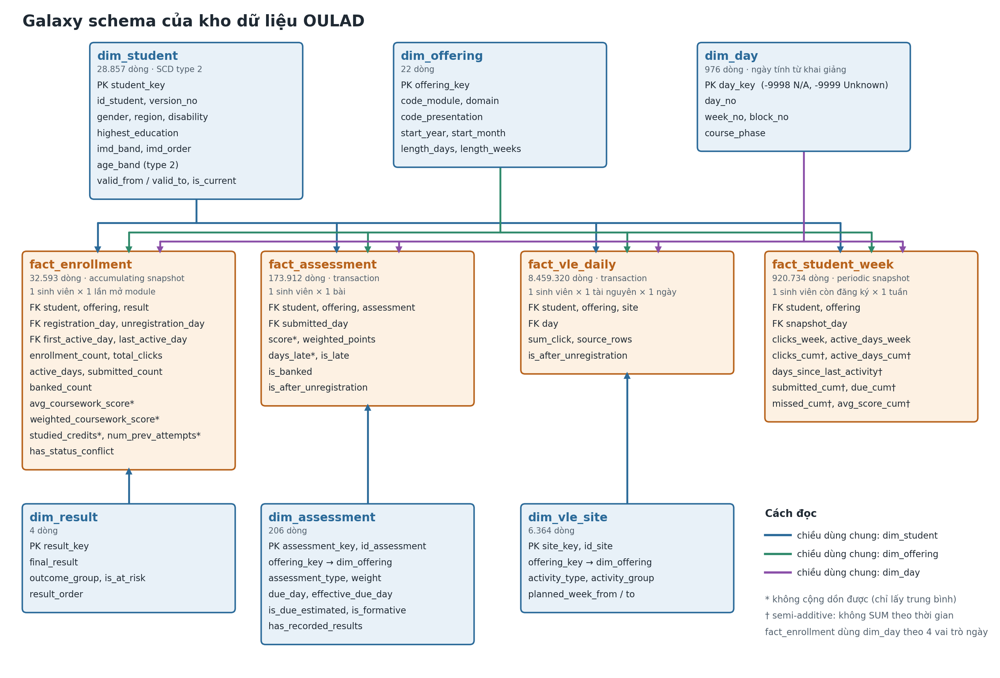

# Phân tích và Thiết kế Kho dữ liệu OULAD

Tài liệu này là phần Bước 1 (phân tích yêu cầu) và Bước 2 (thiết kế kho dữ liệu, ETL) của BTL CO4031. Mọi con số đều lấy từ dữ liệu thật:

- `docs/profiling_output.txt`, `docs/profiling_followup.txt`: kết quả profiling dữ liệu nguồn.
- `docs/validation_output.txt`, `docs/etl_check_output.txt`: kết quả nạp thử thiết kế và SQL ETL trên PostgreSQL.
- `src/sql/`: DDL, nhật ký ETL, bài kiểm tra sau khi nạp và SQL mẫu.

**Quy ước tuần:** `week_no = FLOOR(ngày / 7)` và bắt đầu từ 0. Ví dụ `week_no = 7` là tuần thứ 8 của khóa, kết thúc vào ngày 55.

---

## Phần 1. Phân tích yêu cầu nghiệp vụ

### 1.1. Bối cảnh và bài toán

Open University (Anh) đào tạo từ xa, sinh viên học qua môi trường học tập ảo (VLE). Bộ dữ liệu OULAD [1] ghi lại 7 module, 22 lần mở (2013–2014), 32.593 lượt ghi danh của 28.785 sinh viên.

**Vấn đề: 52,8% lượt ghi danh kết thúc bằng Fail hoặc Withdrawn** (17.208 / 32.593). Tỉ lệ này dao động từ 29,0% (AAA) đến 62,2% (CCC).

**Bài toán:** với số giờ của cố vấn học tập có hạn, cần biết sớm sinh viên nào có nguy cơ cao để can thiệp đúng người, đúng lúc; đồng thời chỉ ra module và bài đánh giá nào cần cải thiện.

### 1.2. Người dùng và quyết định cần hỗ trợ

| Người dùng | Quyết định | Tần suất | Thông tin cần |
|---|---|---|---|
| Cố vấn học tập (tutor) | Tuần này liên hệ sinh viên nào, bằng hình thức gì | Hằng tuần | Danh sách rủi ro, mức tương tác, số bài bỏ lỡ |
| Trưởng học phần | Bài đánh giá hoặc tài nguyên nào cần sửa; phân bổ giờ tutor | Mỗi lần mở | Tỉ lệ nộp bài, điểm, tương tác theo tuần |
| Ban điều hành khoa | So sánh các module, nhóm sinh viên nào cần chính sách hỗ trợ | Mỗi kỳ | Kết quả theo lĩnh vực, module, nhóm nhân khẩu học |

### 1.3. Câu hỏi nghiệp vụ và kết quả kiểm chứng

Mỗi câu hỏi đã được trả lời thử bằng SQL trên kho dữ liệu, xác nhận schema đáp ứng được các câu hỏi này.

**Q1. Kết quả học tập khác nhau thế nào giữa các nhóm?**

| Chiều phân tích | Tỉ lệ có nguy cơ (Fail + Withdrawn) |
|---|---|
| Lĩnh vực | STEM 55,2% · Social Sciences 48,2% |
| Module | AAA 29,0 · GGG 40,3 · EEE 43,8 · BBB 52,5 · FFF 53,0 · DDD 58,4 · CCC 62,2 (%) |
| Mức IMD | Nhìn chung giảm dần, từ 64,8% (0–10%, nghèo nhất) đến 42,5% (90–100%) |
| Trình độ đầu vào | No Formal 70,3 · Lower Than A Level 61,1 · A Level 48,0 · HE 43,8 · Post Graduate 34,5 (%) |
| Khuyết tật | Có 61,9% · Không 51,8% |

**Q2. Sinh viên rút học vào lúc nào?**

| Thời điểm hủy đăng ký | Số lượt | Tỉ lệ |
|---|---|---|
| Trước khai giảng | 2.678 | 26,6% |
| Đúng ngày 0 | 419 | 4,2% |
| Ngày 1–27 | 1.943 | 19,3% |
| Ngày 28–83 | 1.820 | 18,1% |
| Từ ngày 84 | 3.212 | 31,9% |

30,7% ca rút học xảy ra **trước khi khóa học thực sự diễn ra** (trước khai giảng hoặc đúng ngày 0), nên hệ cảnh báo sớm khó phát hiện các ca này bằng hành vi học. Đăng ký sớm cũng không đồng nghĩa với cam kết cao: nhóm đăng ký trước từ 90 ngày rút học 38,2%, còn nhóm đăng ký trước 1–29 ngày chỉ 25,3%.

**Q3. Tương tác VLE khác nhau thế nào giữa các nhóm kết quả?** (`week_no = 7`)

| Kết quả cuối | Sinh viên còn học | Click TB/tuần | Không click trong tuần | Bài bỏ lỡ TB |
|---|---|---|---|---|
| Distinction | 3.024 | 78,1 | 12,2% | 0,16 |
| Pass | 12.358 | 58,3 | 14,6% | 0,20 |
| Fail | 7.039 | 26,1 | 45,9% | 0,69 |
| Withdrawn | 4.102 | 33,9 | 35,4% | 0,62 |

Theo nhóm tài nguyên, click trên mỗi lượt ghi danh của nhóm đạt cao hơn nhóm có nguy cơ khoảng 4–5 lần (Collaboration 483,2 so với 94,7; Content 856,9 so với 191,7). So sánh này chỉ mang tính mô tả vì nhóm Withdrawn học ít tuần hơn.

**Q4. Bài đánh giá nào có vấn đề?**

| Loại | Số lượt nộp | Điểm TB | Dưới 40 điểm | Nộp trễ |
|---|---|---|---|---|
| TMA | 98.426 | 72,6 | 5,4% | 16,8% |
| CMA | 70.527 | 81,0 | 2,5% | 47,2% |
| Exam (chỉ có ở CCC, DDD) | 4.959 | 65,6 | 11,4% | không tính |

Khoan xuống từng bài cho thấy điểm gãy rõ hơn. Ở FFF-2014J, tỉ lệ nộp 5 bài TMA giảm dần từ 77,2% xuống 48,1%, trong khi điểm trung bình của người nộp chỉ dao động trong khoảng 73–79. Điều này gợi ý vấn đề nằm ở việc sinh viên bỏ dở nhiều hơn là bài quá khó, dù điểm chỉ tính trên những người còn nộp.

**Q5. Sinh viên học lại có khác không?** Tỉ lệ có nguy cơ là 50,7% với người học lần đầu, 65,4% khi đã học 1 lần, 72,5% khi đã học từ 2 lần.

**Q6. Có thể cảnh báo sớm không?** Có dấu hiệu rõ. Tại `week_no = 7`, tỉ lệ có nguy cơ theo số bài đã bỏ lỡ là:

| Số bài bỏ lỡ | Sinh viên | Có nguy cơ |
|---|---|---|
| 0 | 18.814 | 33,0% |
| 1 | 5.644 | 53,3% |
| Từ 2 | 2.065 | 92,8% |

Đây mới là tương quan, chưa phải mô hình dự báo. Tỉ lệ nền cũng thấp hơn con số 52,8% vì một phần sinh viên đã rút trước đó: chỉ còn 44,1% ở `week_no = 3`, 42,0% ở `week_no = 7`, 40,2% ở `week_no = 11`.

### 1.4. Chỉ số KPI

| KPI | Công thức | Nguồn | Lưu ý |
|---|---|---|---|
| Tỉ lệ có nguy cơ | Fail + Withdrawn / tổng lượt ghi danh | `fact_enrollment` | Với DSS, tính trên sinh viên còn đăng ký tại tuần đó |
| Tỉ lệ rút học | Withdrawn / tổng lượt ghi danh | `fact_enrollment` | Tách riêng rút trước và sau khai giảng |
| Số sinh viên | `COUNT(DISTINCT id_student)` | `dim_student` | Không đếm `student_key` |
| Tỉ lệ nộp bài | Số lượt nộp / số sinh viên của lần mở | `fact_assessment`, `fact_enrollment` | |
| Tỉ lệ nộp trễ | `is_late` trung bình | `fact_assessment` | TMA và CMA; không tính bài thi, bài banked |
| Điểm trung bình | `AVG(score)` | `fact_assessment` | Không so sánh Exam giữa các module |
| Click mỗi sinh viên mỗi tuần | `AVG(clicks_week)` | `fact_student_week` | Tính cả tuần không hoạt động |
| Tỉ lệ không hoạt động | Số dòng `clicks_week = 0` / tổng số dòng | `fact_student_week` | |
| Số bài bỏ lỡ | `missed_cum` | `fact_student_week` | Tín hiệu mạnh nhất đã thấy ở Q6 |

### 1.5. Yêu cầu đối với kho dữ liệu

- Phân tích được theo các chiều: sinh viên, module/lần mở, thời gian trong khóa, bài đánh giá, tài nguyên, kết quả.
- Hỗ trợ roll-up và drill-down: lĩnh vực → module → lần mở; ngày → tuần → khối 4 tuần; nhóm tài nguyên → loại tài nguyên → tài nguyên.
- Tái hiện được **những gì đã biết tại cuối mỗi tuần** để phục vụ cảnh báo sớm, không để lộ thông tin tương lai.
- Đối chiếu được toàn bộ số liệu với dữ liệu nguồn.

### 1.6. Phạm vi và giới hạn của dữ liệu

Dữ liệu **không có**: ngày lịch thực tế (chỉ có tháng khai giảng), điểm tổng kết, điểm thi của 5/7 module, số giờ của tutor, và thông tin về các can thiệp đã thực hiện. Do đó:

- Hiệu quả can thiệp trong DSS phải là **giả định**, không thể học từ dữ liệu.
- Kết quả phân tích là tương quan, không kết luận được quan hệ nhân quả.
- Dữ liệu từ 2013–2014 và thuộc một trường đào tạo từ xa ở Anh nên không thể suy rộng ngay cho bối cảnh khác.

---

## Phần 2. Dữ liệu nguồn

### 2.1. Các bảng nguồn

| File | Số dòng | Mỗi dòng là | Khóa đã kiểm tra (không trùng) |
|---|---|---|---|
| `courses.csv` | 22 | 1 lần mở module | `code_module, code_presentation` |
| `assessments.csv` | 206 | 1 bài đánh giá | `id_assessment` |
| `vle.csv` | 6.364 | 1 tài nguyên, thuộc đúng 1 lần mở | `id_site` |
| `studentInfo.csv` | 32.593 | 1 lượt ghi danh | `code_module, code_presentation, id_student` |
| `studentRegistration.csv` | 32.593 | 1 lượt ghi danh | như trên |
| `studentAssessment.csv` | 173.912 | 1 lượt nộp | `id_assessment, id_student` |
| `studentVle.csv` | 10.655.280 | 1 bản ghi click | **Không có khóa**: xem mục 2.2 |

Không có khóa ngoại nào bị mồ côi giữa các bảng.

### 2.2. Vấn đề chất lượng dữ liệu và quyết định xử lý

| Vấn đề | Số liệu | Hệ quả nếu bỏ qua | Quyết định |
|---|---|---|---|
| Ngày là số ngày tính từ khai giảng, có thể âm | Từ -365 đến 608 | Không dùng được chiều ngày lịch thông thường | Tạo `dim_day` theo ngày tương đối |
| `studentVle` không duy nhất theo sinh viên × tài nguyên × ngày | 10.655.280 dòng → 8.459.320 khóa | Sai grain, không đặt được khóa chính | `SUM(sum_click)`, lưu số dòng gộp vào `source_rows` |
| Trong đó có dòng trùng hoàn toàn | 787.170 dòng, 3,19% tổng click | Xóa đi sẽ mất click | **Giữ lại**: xem giải thích bên dưới |
| Giá trị thiếu ghi là chuỗi rỗng có dấu nháy | Mọi cột có thể thiếu | `::int` báo lỗi khi đổi kiểu | `NULLIF(cot, '')` khi transform |
| `imd_band` thiếu | 1.111 dòng; 89,7% thuộc North Region (thiếu 40,1%) và Ireland (22,5%) | Thiếu không ngẫu nhiên, điền bù sẽ sai lệch | Gán `Unknown`, không điền bù; tỉ lệ có nguy cơ của nhóm này (34,3%) khác hẳn các nhóm khác |
| `imd_band` sai định dạng | `10-20` (3.516 dòng) | Sắp xếp và lọc sai | Sửa thành `10-20%`, thêm `imd_order` |
| `age_band` đổi giữa các lượt ghi danh | 72 sinh viên, luôn đổi lên nhóm tuổi cao hơn | Mất thông tin lịch sử | SCD type 2; 1 sinh viên có 2 nhóm tuổi trong cùng một kỳ nên tra theo `(id_student, age_band)`, không tra theo khoảng thời gian |
| `studied_credits` là tổng tín chỉ của sinh viên trong kỳ | 1.078/1.078 trường hợp học nhiều module có cùng giá trị | SUM sẽ tính trùng | Đánh dấu không cộng được |
| `date` của bài thi bị thiếu | 11 bài | Không tính được hạn nộp | `effective_due_day` = ngày cuối khóa (quy ước của paper [1]), giữ cờ `is_due_estimated` |
| Điểm thi chỉ có ở CCC và DDD | 18 bài thi không có lượt nộp nào | Thiếu điểm tổng kết | Không tính điểm tổng kết; dùng `final_result`; cờ `has_recorded_results` |
| Thời điểm nộp bài thi không khớp hạn | Bài 25354: trung vị sớm 20 ngày so với `date` | Chỉ số trễ vô nghĩa | `days_late = NULL` với Exam |
| Trọng số bằng 0 | 56 bài; toàn bộ bài thường kỳ của GGG | Chia cho 0 | Cờ `is_formative`; điểm có trọng số để NULL |
| Bài banked (chuyển điểm từ lần học trước) | 1.909 dòng, đều ghi `date_submitted = -1` | Ngày giả làm sai chỉ số thời gian | `submitted_day_key = -9998`, `days_late = NULL` |
| `score` thiếu | 173 dòng, đều là TMA | | Giữ NULL |
| Thiếu ngày đăng ký | 45 dòng | | `day_key = -9999` (Không rõ) |
| Không có ngày hủy | 22.521 dòng | Cần phân biệt "không hủy" với "thiếu dữ liệu" | Chưa rút: `-9998` (Không áp dụng); Withdrawn: `-9999` (Không rõ) |
| Trạng thái mâu thuẫn | 93 Withdrawn không có ngày hủy; 9 Fail có ngày hủy | | Giữ nguyên, `has_status_conflict = TRUE` |
| Hoạt động sau khi hủy đăng ký | 601 lượt nộp, 98.745 click (0,25%) | Rò rỉ thông tin vào mô hình | Giữ trong fact, gắn `is_after_unregistration`, loại khỏi snapshot |
| `week_from`, `week_to` của `vle` | Chỉ có ở 17,6% tài nguyên | | Giữ để tham khảo, không dùng cho phân tích |

**Vì sao giữ các dòng trùng trong `studentVle`:** nguồn không có cột giờ nên không thể phân biệt lỗi với nhiều lượt tương tác trong ngày. Bằng chứng nghiêng về nhiều lượt tương tác:

- 73% khóa có nhiều dòng mang các giá trị click khác nhau, nên dữ liệu không phải tổng theo ngày.
- 94,1% khóa có từ 5 dòng trở lên thuộc loại `quiz`, phù hợp với việc làm bài nhiều lần.
- Dòng trùng tập trung ở giá trị nhỏ: 74% có `sum_click = 1`, trong khi tỉ lệ này ở toàn bộ dữ liệu là 48%. Giá trị nhỏ dễ trùng nhau một cách tự nhiên.

Vì vậy nhóm giữ lại các dòng này. Nếu cách hiểu này sai, tổng click cao hơn thực tế tối đa 3,19%.

---

## Phần 3. Thiết kế kho dữ liệu

### 3.1. Phương pháp

Thiết kế theo 4 bước của Kimball [2]: chọn quy trình nghiệp vụ → khai báo grain → xác định chiều → xác định độ đo. Mô hình được chọn là **galaxy schema**, gồm 4 bảng fact dùng chung các bảng chiều.

### 3.2. Bus matrix

| Quy trình nghiệp vụ | Bảng fact | student | offering | day | result | assessment | vle_site |
|---|---|---|---|---|---|---|---|
| Ghi danh và kết quả | `fact_enrollment` | ✓ | ✓ | ✓ (4 vai trò) | ✓ | | |
| Nộp bài đánh giá | `fact_assessment` | ✓ | ✓ | ✓ | | ✓ | |
| Tương tác VLE | `fact_vle_daily` | ✓ | ✓ | ✓ | | | ✓ |
| Theo dõi tiến độ tuần | `fact_student_week` | ✓ | ✓ | ✓ | | | |

### 3.3. Sơ đồ

### 3.4. Các bảng fact

| Bảng | Grain | Loại | Số dòng | Độ đo chính |
|---|---|---|---|---|
| `fact_enrollment` | 1 sinh viên × 1 lần mở | Accumulating snapshot | 32.593 | Tổng click, số ngày hoạt động, số bài đã nộp, điểm TB |
| `fact_assessment` | 1 sinh viên × 1 bài | Transaction | 173.912 | Điểm, số ngày trễ |
| `fact_vle_daily` | 1 sinh viên × 1 tài nguyên × 1 ngày | Transaction | 8.459.320 | Số click |
| `fact_student_week` | 1 sinh viên còn đăng ký × 1 tuần | Periodic snapshot | 920.734 | Click tuần và lũy kế, số bài bỏ lỡ, điểm lũy kế |

Bảng tổng hợp `agg_vle_offering_week_activity` có 8.436 dòng, ít hơn khoảng 1.000 lần so với `fact_vle_daily`, dùng cho dashboard.

**Tính cộng dồn của độ đo:**

| Loại | Độ đo |
|---|---|
| Cộng được theo mọi chiều | `sum_click`, `total_clicks`, `clicks_week`, `enrollment_count`, `submitted_count` |
| Semi-additive: không cộng theo thời gian | Các cột `*_cum` và `days_since_last_activity` trong `fact_student_week` |
| Không cộng được | `score`, `days_late`, `avg_*`, `weighted_coursework_score`, `studied_credits`, `num_prev_attempts` |

### 3.5. Các bảng chiều

| Bảng | Số dòng | Vai trò | Phân cấp |
|---|---|---|---|
| `dim_student` | 28.857 | Nhân khẩu học, SCD type 2 cho `age_band` | region; imd_band; age_band |
| `dim_offering` | 22 | Một lần mở module | domain → module → lần mở; năm → lần mở |
| `dim_day` | 976 | Ngày tương đối -365..608 và 2 dòng đặc biệt | ngày → tuần → khối 4 tuần → giai đoạn |
| `dim_result` | 4 | Kết quả cuối khóa | outcome_group → final_result |
| `dim_assessment` | 206 | Bài đánh giá | loại → bài |
| `dim_vle_site` | 6.364 | Tài nguyên học | activity_group → activity_type → tài nguyên |

`domain` không có trong CSV, được lấy từ Bảng 1 của paper [1]: AAA, BBB, GGG là Social Sciences; CCC, DDD, EEE, FFF là STEM.

`activity_group` **do nhóm tự đặt** dựa theo tên loại tài nguyên, tài liệu nguồn không định nghĩa:

| Nhóm | Các `activity_type` | Tỉ lệ click |
|---|---|---|
| Content | oucontent, resource, subpage, page, url, dualpane, folder, htmlactivity, sharedsubpage, repeatactivity, glossary | 41,6% |
| Collaboration | forumng, ouwiki, oucollaborate, ouelluminate, dataplus | 22,9% |
| Practice | quiz, externalquiz, questionnaire | 18,0% |
| Navigation | homepage | 17,5% |

### 3.6. Các quyết định thiết kế chính

**1. Star thay vì snowflake.** Module và lần mở được gộp vào `dim_offering`. Độ dài khóa phụ thuộc vào cả cặp module–lần mở, và bảng chỉ có 22 dòng nên tách ra không tiết kiệm được gì mà còn thêm phép join. Ngoại lệ duy nhất: `dim_assessment` và `dim_vle_site` giữ `offering_key` (outrigger), vì 18 bài thi và 96 tài nguyên chưa từng có hoạt động nên không xuất hiện trong fact.

**2. Chiều ngày tương đối.** Nguồn chỉ cho biết tháng khai giảng (B = tháng 2, J = tháng 10). Tự đặt ngày lịch sẽ tạo ra thông tin giả, nên `dim_day` chỉ chứa ngày tương đối, còn tháng và năm nằm ở `dim_offering`. Các mốc như "sau khi kết thúc khóa" phụ thuộc độ dài từng lần mở nên không đưa vào `dim_day`.

**3. Dòng đặc biệt thay cho NULL ở khóa ngoại.** `-9998` là Không áp dụng (chưa từng hủy đăng ký, bài banked), `-9999` là Không rõ (thiếu dữ liệu). Hai ý nghĩa này khác nhau, và join không làm mất dòng.

**4. SCD type 2 cho `age_band`.** Chỉ `age_band` thay đổi, ở 72 sinh viên. Các thuộc tính còn lại không đổi trong dữ liệu. Hệ quả: phải đếm sinh viên bằng `COUNT(DISTINCT id_student)`, cho ra 28.785, trong khi đếm `student_key` sẽ ra 28.857.

**5. Snapshot đầy đủ các tuần.** `fact_student_week` có cả tuần không hoạt động, vì không click cũng là tín hiệu rủi ro: 45,9% sinh viên Fail không click trong `week_no = 7`, so với 14,6% ở nhóm Pass. Chỉ tính tuần có hoạt động thì sẽ mất tín hiệu này.

**6. Snapshot chống rò rỉ thông tin:**

- Chỉ có dòng khi sinh viên còn đăng ký vào cuối tuần đó (đã kiểm tra: 0 dòng vi phạm).
- Không chứa kết quả cuối khóa; muốn lấy nhãn phải join sang `fact_enrollment`.
- Chỉ dùng dữ liệu đến cuối tuần đó, không tính hoạt động sau khi hủy.

**7. Không phân vùng bảng ở phiên bản này.** `fact_vle_daily` có 8,46 triệu dòng; bộ kiểm thử trên một máy cá nhân chạy được với chỉ mục hiện có (truy vấn quét toàn bảng khoảng 1,5 giây). Có thể phân vùng theo `offering_key` nếu dữ liệu lớn hơn.

---

## Phần 4. Thiết kế ETL

### 4.1. Kiến trúc và luồng xử lý

Dữ liệu đi qua ba vùng: **file CSV nguồn → schema `staging` (TEXT, y nguyên nguồn) → schema `dw` (đã làm sạch)**. Schema `etl` lưu nhật ký chạy.

**Cách hiện thực đề xuất:** Python chỉ điều phối thứ tự các job và ghi log; việc biến đổi được viết bằng SQL chạy ngay trong PostgreSQL. Lý do là dữ liệu đã nằm trong cơ sở dữ liệu nên không phải kéo 10 triệu dòng vào bộ nhớ. Khi chạy thử, câu SQL tạo `fact_vle_daily` mất khoảng 27 giây và `fact_student_week` khoảng 8 giây.

**Danh sách job**, chạy tuần tự:

| Job | Việc làm | Đầu vào | Đầu ra | Số dòng đúng |
|---|---|---|---|---|
| J01 | Kiểm tra đủ 7 file, đúng tên cột | File CSV | Không có | |
| J02 | Tạo lại schema; `COPY` vào staging | J01, file DDL | 7 bảng `staging` | Xem mục 2.1 |
| J03 | Tạo `dim_student` (SCD type 2) | `student_info` | `dim_student` | 28.857 |
| J04 | Tạo `dim_offering` | `courses`, bảng lĩnh vực | `dim_offering` | 22 |
| J05 | Sinh `dim_day` và `dim_result` | Sinh tự động | 2 bảng | 976; 4 |
| J06 | Tạo `dim_assessment`, `dim_vle_site` | J04, `assessments`, `vle` | 2 bảng | 206; 6.364 |
| J07 | Tạo `fact_assessment` | J03, J04, J05, J06 | `fact_assessment` | 173.912 |
| J08 | Tạo `fact_vle_daily` | J03, J04, J05, J06 | `fact_vle_daily` | 8.459.320 |
| J09 | Tạo `fact_enrollment` | J03, J04, J05, J07, J08 | `fact_enrollment` | 32.593 |
| J10 | Tạo `fact_student_week` | J05, J06, J07, J08, J09 | `fact_student_week` | 920.734 |
| J11 | Làm mới bảng tổng hợp | J05, J06, J08 | `agg_vle_offering_week_activity` | 8.436 |
| J12 | `ANALYZE` để cập nhật thống kê | Toàn bộ `dw` | | |
| J13 | Chạy bài kiểm tra ở mục 4.4 | Toàn bộ | `etl.check_result` | 29 phép đều đạt |

**Vì sao theo thứ tự này:** bảng chiều phải có trước vì fact có khóa ngoại trỏ tới; `dim_assessment` và `dim_vle_site` cần `offering_key`; `fact_enrollment` tổng hợp từ hai fact giao dịch; `fact_student_week` cần cả ba fact.

**Chiến lược nạp:** OULAD là dữ liệu lịch sử cố định nên dùng nạp lại toàn bộ (full reload): J02 xóa và tạo lại mọi bảng, nên chạy lại nhiều lần vẫn cho cùng kết quả. Nếu sau này có lần mở mới, chỉ cần nạp thêm theo `offering_key` và kiểm tra thay đổi `age_band` để tạo phiên bản SCD mới; phần này chưa được thiết kế chi tiết vì nằm ngoài phạm vi bài.

### 4.2. Ánh xạ nguồn – đích

**Chiều**

| Cột đích | Nguồn | Biến đổi |
|---|---|---|
| `dim_student.*` | `student_info` | Mỗi cặp `(id_student, age_band)` là 1 phiên bản; `version_no` tăng theo nhóm tuổi; `valid_from/to` là lần mở đầu/cuối xuất hiện |
| `dim_student.imd_band` | `imd_band` | `''` → `Unknown`; `10-20` → `10-20%` |
| `dim_student.imd_order` | `imd_band` | 0-10% → 1 … 90-100% → 10; Unknown → NULL |
| `dim_offering.domain` | Bảng 1 của paper [1] | Tra cứu theo `code_module` |
| `dim_offering.start_year`, `start_month` | `code_presentation` | 4 ký tự đầu; B → 2, J → 10 |
| `dim_offering.length_weeks` | `module_presentation_length` | `CEIL(length / 7)` |
| `dim_day.week_no`, `block_no` | Sinh tự động | `FLOOR(day / 7)`, `FLOOR(day / 28)` |
| `dim_assessment.effective_due_day` | `assessments.date` | Thiếu thì lấy `length_days` |
| `dim_assessment.is_formative` | `weight` | `weight = 0` |
| `dim_assessment.has_recorded_results` | `student_assessment` | Có ít nhất một lượt nộp |
| `dim_vle_site.activity_group` | `activity_type` | Bảng ở mục 3.5 |

**Fact**

| Cột đích | Nguồn | Biến đổi |
|---|---|---|
| `*.student_key` | `id_student` + `age_band` của lượt ghi danh | Tra `dim_student` |
| `fact_enrollment.registration_day_key` | `date_registration` | Thiếu → -9999 |
| `fact_enrollment.unregistration_day_key` | `date_unregistration` | Thiếu: Withdrawn → -9999, còn lại → -9998 |
| `fact_enrollment.first/last_active_day_key` | `student_vle.date` | MIN, MAX; không có → -9998 |
| `fact_enrollment.total_clicks`, `active_days` | `student_vle` | SUM click; số ngày khác nhau; không có → 0 |
| `fact_enrollment.submitted_count`, `banked_count` | `student_assessment` | Chỉ TMA + CMA; tách banked |
| `fact_enrollment.weighted_coursework_score` | `score`, `weight` | `SUM(score × weight) / SUM(weight)` trên bài có điểm; tổng trọng số = 0 → NULL |
| `fact_enrollment.has_status_conflict` | `final_result`, `date_unregistration` | Withdrawn không có ngày hủy, hoặc Fail có ngày hủy |
| `fact_assessment.submitted_day_key` | `date_submitted` | Banked → -9998 |
| `fact_assessment.weighted_points` | `score`, `weight` | `score × weight / 100` |
| `fact_assessment.days_late`, `is_late` | `date_submitted`, `effective_due_day` | Hiệu hai ngày; banked hoặc Exam → NULL |
| `fact_*.is_after_unregistration` | ngày hoạt động, `date_unregistration` | Ngày hoạt động > ngày hủy |
| `fact_vle_daily.sum_click`, `source_rows` | `student_vle` | `SUM`, `COUNT(*)` theo sinh viên × tài nguyên × ngày |

**`fact_student_week`:** với mỗi lượt ghi danh và mỗi tuần `w` từ 0 đến `length_weeks - 1`, đặt `end = 7w + 6`. Chỉ tạo dòng khi `(reg IS NULL OR reg <= end) AND (unreg IS NULL OR unreg > end)`.

| Cột | Cách tính |
|---|---|
| `clicks_week`, `active_days_week` | Click và số ngày hoạt động trong đoạn `[7w, end]` |
| `clicks_cum`, `active_days_cum` | Tính đến `end`, gồm cả trước khai giảng |
| `days_since_last_activity` | `end` trừ ngày hoạt động gần nhất; chưa hoạt động lần nào → NULL |
| `submitted_cum`, `avg_score_cum` | TMA + CMA, không banked, `date_submitted <= end` |
| `due_cum` | Số TMA + CMA có `effective_due_day <= end` |
| `missed_cum` | Bài đã đến hạn, không banked và chưa nộp tính đến `end` |

Bài nộp sau đó sẽ được tính lại là không bỏ lỡ ở các tuần sau, đúng với những gì tutor nhìn thấy tại thời điểm đó.

### 4.3. Xử lý lỗi

| Tình huống | Cách xử lý |
|---|---|
| Thiếu file, sai tên cột, không đổi được kiểu dữ liệu | Dừng toàn bộ, job và lần chạy ghi `FAILED` |
| Vi phạm khóa chính, khóa ngoại, `CHECK` | Dừng toàn bộ. Đây là dấu hiệu dữ liệu nguồn hoặc logic ETL đã thay đổi |
| Dòng bất thường đã biết (mục 2.2) | **Không loại bỏ dòng nào**: giữ lại và gắn cờ, vì mọi khóa ngoại đều hợp lệ |
| Bài kiểm tra J13 không đạt | Lần chạy ghi `FAILED`; không dùng dữ liệu này cho dashboard hay DSS |
| Chạy lại sau khi lỗi | Chạy lại từ đầu, vì J02 đã tạo lại toàn bộ bảng |

Mỗi job chạy trong một transaction, nên lỗi giữa chừng không để lại bảng nạp dở.

**Nhật ký** (`src/sql/02_ddl_etl_log.sql`):

| Bảng | Mỗi dòng là | Nội dung |
|---|---|---|
| `etl.run` | Một lần chạy | Thời gian bắt đầu, kết thúc, trạng thái |
| `etl.job_log` | Một job trong một lần chạy | Bảng đích, thời gian, số dòng ghi, trạng thái, thông báo lỗi |
| `etl.check_result` | Một phép kiểm tra | Giá trị mong đợi, giá trị thực, đạt hay không |

### 4.4. Kiểm tra sau khi nạp

Sai bất kỳ con số nào ở đây tức là ETL sai. Toàn bộ đã được viết thành 29 phép kiểm tra chạy được trong `src/sql/03_kiem_tra_sau_nap.sql`:

| Kiểm tra | Giá trị đúng |
|---|---|
| Số dòng `staging.student_vle` = `SUM(source_rows)` trong `fact_vle_daily` | 10.655.280 |
| Tổng click ở staging, `fact_vle_daily`, `fact_enrollment`, bảng tổng hợp | 39.605.099 ở cả bốn nơi |
| Số dòng `fact_enrollment` / `fact_assessment` | 32.593 / 173.912 |
| Số dòng `fact_vle_daily` / `fact_student_week` | 8.459.320 / 920.734 |
| `dim_student`: số dòng / số sinh viên khác nhau | 28.857 / 28.785 |
| `fact_assessment`: có điểm / banked / sau khi hủy / trễ | 173.739 / 1.909 / 601 / 49.311 |
| `fact_vle_daily`: click sau khi hủy | 98.745 |
| `fact_enrollment`: mâu thuẫn trạng thái / không rõ ngày đăng ký / không rõ ngày hủy | 102 / 45 / 93 |
| `fact_enrollment`: không có hoạt động VLE | 3.365 |
| `fact_student_week`: `missed_cum > due_cum` hoặc dòng sau ngày hủy | 0 |

### 4.5. SQL mẫu cho các job khó

Ba job khó nhất có sẵn SQL mẫu trong `src/sql/etl_mau/`:

| File | Job | Điểm khó |
|---|---|---|
| `j03_dim_student.sql` | J03 | Sinh phiên bản SCD type 2, sửa `imd_band` |
| `j08_fact_vle_daily.sql` | J08 | Gộp nhiều dòng nguồn, tra khóa, gắn cờ sau khi hủy |
| `j10_fact_student_week.sql` | J10 | Sinh đủ các tuần, tính lũy kế, không rò rỉ thông tin |

Bảy bảng còn lại làm theo bảng ánh xạ ở mục 4.2.

---

## Phần 5. Kết quả kiểm chứng thiết kế

**Đã kiểm tra** (`src/profiling/validate_design.py`, PostgreSQL 16.2):

- DDL chạy được; toàn bộ dữ liệu thật nạp thành công, các ràng buộc khóa chính, khóa ngoại và `CHECK` đều được kiểm tra khi nạp.
- Mọi con số ở mục 4.4 khớp.
- Hai cách làm khác nhau cho cùng kết quả: SQL mẫu chạy trên staging so với bảng dựng bằng pandas đều **0 khác biệt** ở `dim_student` (28.857 dòng), `fact_vle_daily` (8.459.320 dòng) và `fact_student_week` (920.734 dòng, mọi cột; xem `docs/etl_check_output.txt`). Hai cách cùng do một người viết từ một đặc tả, nên phép thử này bắt được lỗi hiện thực, không bắt được lỗi trong chính đặc tả.
- Đối chiếu thủ công một sinh viên (28400) từ CSV đến `fact_student_week` cho kết quả đúng.
- 29 phép kiểm tra của `03_kiem_tra_sau_nap.sql` đều đạt.
- Cả 6 câu hỏi nghiệp vụ đều trả lời được bằng SQL, gồm `ROLLUP`, `CUBE` và drill-down.

**Chưa kiểm tra:**

- ETL hoàn chỉnh: mới có SQL mẫu cho 3 bảng; 7 bảng còn lại, chương trình điều phối (J01–J13) và việc ghi log chưa được viết.
- Môi trường Docker, tốc độ dashboard khi có nhiều người dùng.

**Ghi chú:** 3.398 lượt ghi danh không có dòng snapshot nào, đúng theo thiết kế: 3.397 ca đã hủy trước khi hết ngày 6; ca còn lại (sinh viên 636807, BBB-2014J) đăng ký ngày 16 và hủy ngày 17, tức không còn đăng ký vào cuối tuần nào.

**Dung lượng:** `fact_vle_daily` 904 MB (gồm chỉ mục), `staging.student_vle` 613 MB, `fact_student_week` 119 MB. Có thể xóa staging sau khi nạp xong.

---

## Phần 6. Bàn giao cho nhóm

> Phần này dành cho nội bộ nhóm, không đưa vào báo cáo.

**Bạn làm ETL**

- Dùng thẳng `src/sql/00_ddl_staging.sql`, `01_ddl_dw.sql`, `02_ddl_etl_log.sql`.
- Làm theo danh sách job J01–J13 ở mục 4.1. SQL của J03, J08, J10 có sẵn trong `src/sql/etl_mau/`; còn lại viết theo bảng ánh xạ ở mục 4.2.
- Đổi kiểu dữ liệu phải qua `NULLIF(cot, '')`. `COPY` giữ `""` thành chuỗi rỗng, nên ép kiểu trực tiếp sẽ báo lỗi.
- Dùng `src/sql/03_kiem_tra_sau_nap.sql` làm J13: tất cả 29 dòng phải đạt.

**Bạn làm OLAP và dashboard**

- Đếm sinh viên bằng `COUNT(DISTINCT id_student)`; không `SUM(studied_credits)`.
- `dim_assessment`, `dim_vle_site` và fact cùng có `offering_key`, nên join phải dùng `ON`. `USING (offering_key)` sẽ báo lỗi.
- So sánh giữa các kỳ phải cùng module: 2013B chỉ có BBB, DDD, FFF; CCC chỉ có năm 2014; AAA chỉ có đợt J. So sánh chung sẽ bị lệch.
- Giữ `Unknown` của IMD thành một nhóm riêng; không so sánh điểm thi ngoài CCC và DDD.

**Bạn làm DSS**

- Tập sinh viên cần dự báo là các dòng `fact_student_week` của tuần đang xét. Tỉ lệ nền khoảng 40–44%, không phải 52,8%.
- Lấy nhãn bằng cách join `fact_enrollment` và `dim_result`.
- 3.397 ca hủy trước khi hết ngày 6 không nằm trong tập dự báo; nên báo cáo riêng.
- CCC chỉ có dữ liệu 2014. Nếu train 2013 và test 2014 thì đây là module mới hoàn toàn với mô hình; nên báo cáo kết quả riêng cho CCC.
- `avg_score_cum` coi điểm là biết ngay khi nộp, trong khi thực tế phải chờ chấm, và nguồn không có ngày trả điểm. Điểm số đánh giá mô hình vì vậy có thể hơi lạc quan; nên thử thêm trường hợp trễ 1–2 tuần.
- Click khác nhau nhiều giữa các module, nên chuẩn hóa theo từng lần mở trước khi đưa vào mô hình.
- Hiệu quả can thiệp là giả định, phải ghi rõ trong báo cáo và đưa vào phân tích độ nhạy.

---

## Quy ước nhóm đã thống nhất

1. "Có nguy cơ" gồm cả Fail và Withdrawn, vì cả hai đều là không hoàn thành module.
2. Các dòng trùng hoàn toàn trong `studentVle` là những lượt tương tác khác nhau có số click tình cờ bằng nhau, nên được giữ lại (nếu sai, tổng click cao hơn thực tế tối đa 3,19%).
3. 20 `activity_type` được chia thành 4 nhóm như bảng ở mục 3.5.

## Tài liệu tham khảo

[1] J. Kuzilek, M. Hlosta, Z. Zdrahal, "Open University Learning Analytics dataset," *Scientific Data*, vol. 4, 170171, 2017. doi:10.1038/sdata.2017.171

[2] R. Kimball, M. Ross, *The Data Warehouse Toolkit*, 3rd ed. Wiley, 2013.
